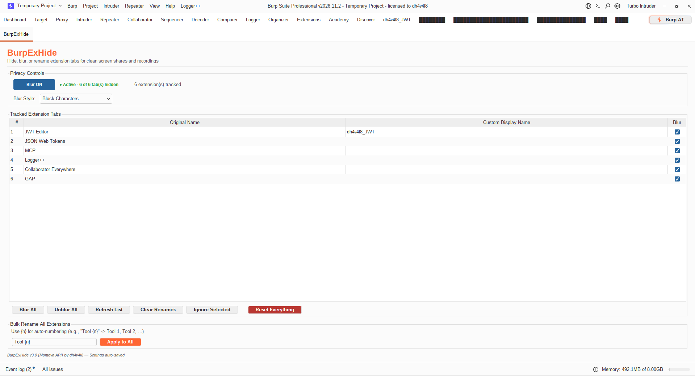

# BurpExHide

**Protect your operational security during screen shares, live demos, and report screenshots by hiding, blurring, or renaming Burp Suite extension tabs in real time.**

Built with the modern **Montoya API** for Burp Suite Professional and Community Edition.



---

## Who Is BurpExHide For?

In real-world security engagements, your loaded Burp Suite extensions often reveal your custom methodology, private automation, or internal tooling. **BurpExHide** is designed for:

* **Penetration Testers & Red Teamers:** Keep proprietary or in-house extensions confidential during live client screen shares, executive walkthroughs, and Proof-of-Concept (PoC) recordings.
* **Bug Bounty Hunters:** Take clean report screenshots and share live workflows with peers without exposing private recon or exploitation plugins.
* **Security Educators, Streamers & Content Creators:** Maintain a clean, distraction-free workspace when recording YouTube tutorials, hosting workshops, or livestreaming.
* **Consultants & Trainers:** Replace noisy or technical extension names with clean, structured aliases (e.g., `Audit 1`, `Module A`) during presentations.

---

## Key Features

* **Built on Montoya API (v3.0):** Modern, lightweight architecture with clean lifecycle management and zero legacy API dependencies.
* **Real-Time Tab Masking:** Instantly conceal extension tab names using 5 built-in styles (`Block Characters`, `Asterisks`, `Dots`, `Underscores`, or `Blank`).
* **Per-Tab & Bulk Renaming:** Double-click any extension in the table to assign a custom alias, or use bulk patterns with `{n}` auto-numbering (e.g., `Tool {n}` → `Tool 1`, `Tool 2`, ...).
* **Component-Based Tracking:** Tracks underlying Swing UI components rather than tab index numbers, ensuring stability even when tabs wrap across multiple rows or new extensions are loaded mid-session.
* **Smart Built-In Protection:** Automatically ignores core Burp Suite tabs (including `Dashboard`, `Proxy`, `Repeater`, `Extensions`, `Academy`, `Discover`, and `Burp AI`). Includes a one-click **Ignore Selected** button to permanently exclude any future built-in tabs.
* **Auto-Save Preferences:** Automatically persists your blur state, style, custom aliases, and ignored tabs using the native Montoya `Preferences` API—without interfering with Burp project backups.
* **Native Light & Dark Theme Support:** Adapts automatically to your active Burp Suite theme.
* **Clean Unloading:** Unloading the extension immediately stops background timers and restores every original tab title with zero restart required.

---

## Controls Overview

| Control | Description |
| :--- | :--- |
| **Blur ON / OFF** | Master toggle to enable or disable concealment across all tracked extension tabs. |
| **Blur Style** | Switch dynamically between Block Characters, Asterisks, Dots, Underscores, or Blank spaces. |
| **Blur All / Unblur All** | Quickly check or uncheck all tracked extensions in the table. |
| **Refresh List** | Manually rescan the Burp UI to detect newly loaded or unloaded extension tabs. |
| **Clear Renames** | Remove all custom display names and revert active tabs to the selected blur style. |
| **Ignore Selected** | Permanently exclude the highlighted tab from tracking and restore its original name. |
| **Reset Everything** | Restore all original tab names, clear custom aliases, and reset ignored tabs to defaults. |

---

## Building from Source

### Prerequisites
* Java JDK 17 or later
* Gradle

### Build Steps
```bash
git clone [https://github.com/Dh4v4l8/BurpExHide.git](https://github.com/Dh4v4l8/BurpExHide.git)
cd BurpExHide
gradle jar
