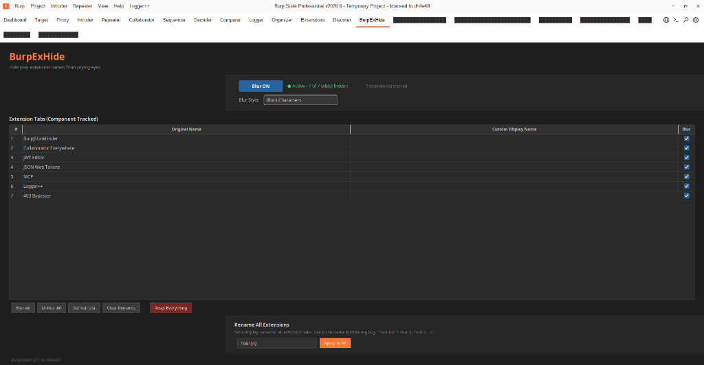

# BurpExHide

**Hide, blur, and rename your Burp Suite extension tabs to protect operational privacy from prying eyes.**

**Author:** dh4v4l8



---

## Why BurpExHide?

When performing security assessments, penetration testing, or bug bounty hunting, your customized suite of Burp extensions often represents proprietary methodologies, custom in-house tooling, or sensitive discovery frameworks. 

During live screen shares, team collaboration meetings, client presentations, video tutorials, or screenshot reporting, having sensitive tool names plainly visible on your top tab bar exposes your workflow and breaks operational security (OpSec).

**BurpExHide** solves this completely by giving you granular, real-time control over how every loaded extension appears in your user interface without interrupting their actual background functionality.

---

## Key Features & Highlights

* **Real-Time Visual Concealment:** Instantly masks all custom extension names in the Burp Suite tab bar while keeping core built-in tools (Dashboard, Proxy, Target, Intruder, Repeater, etc.) completely untouched and functional.
* **Component-Tracked Engine (v2.1):** Utilizes reliable Java Swing GUI component tracking rather than numerical indices. Your tabs will never lose their blurred state or get orphaned, even when dozens of tools are loaded or when tabs wrap to multi-line menus.
* **Self-Healing BApp Detection:** Features an automatic background monitor that runs silently without stealing focus. If you install a brand-new tool from the BApp Store while privacy mode is active, BurpExHide instantly detects the new tab and conceals it within milliseconds.
* **Per-Tab Custom Renaming:** Directly edit the display label of any specific tool using an interactive control table. For example, mask an internal scanner as simply "Module A" or "Scanner".
* **Bulk Pattern Renaming:** Apply universal naming conventions across your entire workspace in one click using simple placeholders. Entering `Tool {n}` automatically renames all extension tabs into a neat sequential line: `Tool 1`, `Tool 2`, `Tool 3`, and so forth.
* **Customizable Concealment Styles:** Choose the aesthetic that fits your presentation format best from five built-in styles:
  * Block Characters: `████████████`
  * Asterisks: `************`
  * Dots: `••••••••••••`
  * Underscores: `____________`
  * Blank Spaces: `            `
* **Granular Exclusions:** Each detected extension includes a toggle checkbox. Uncheck any tool to keep its real name visible while masking all remaining tabs around it.
* **Flawless Reset & Clean Unloading:** Includes a dedicated "Reset Everything" feature that cleanly removes all custom naming rules and returns every tool to its official name. Unloading the extension immediately restores standard Burp Suite formatting without restarting the application.

---

## Installation & Build Guide

### Prerequisites
* Java JDK 8 or later
* Burp Suite Professional or Community Edition

### Building from Source
Open your terminal in the project root directory and execute the automated build script:

```bash
chmod +x build.sh
./build.sh
```

Upon success, this compiles the Java binaries and packages them into `BurpExHide.jar` inside the current directory.

### Loading into Burp Suite
1. Launch **Burp Suite**.
2. Navigate to **Extensions -> Installed** and click the **Add** button.
3. Select **Java** under Extension type.
4. Click **Select file...** and pick the newly compiled `BurpExHide.jar`.
5. Click **Next** to load the extension. You will immediately see a new **BurpExHide** settings tab appear in your suite.

---

## Step-by-Step Usage Guide

### Basic Privacy Toggle
* **Activate / Deactivate:** Click the prominent orange **Blur ON / OFF** toggle at the very top of the BurpExHide control interface. When ON, all tracked tools transition into concealed mode instantly.
* **Change Style:** Use the **Blur Style** dropdown menu to dynamically switch between solid block characters, asterisks, dots, underscores, or blank space layouts.

### Customizing Individual Tabs
1. Open the **BurpExHide** management tab.
2. Review the interactive table listing all currently running extension components.
3. Double-click any cell within the **Custom Display Name** column and type an alias (e.g., `Audit Unit`). Press **Enter** to apply your custom alias to the actual tab bar immediately.

### Applying Bulk Rename Patterns
1. Locate the **Rename All Extensions** input bar at the bottom of the interface.
2. Enter a template string containing the `{n}` auto-numbering parameter (for example: `Project Tab {n}` or `Module {n}`).
3. Click the **Apply to All** button. Every extension will adopt your custom sequence instantly.

### Quick Command Summary Table

| Control Button | Action & Behavior Description |
| :--- | :--- |
| **Blur All** | Checks all extension boxes in the tracking table and enables full concealment across the suite. |
| **Unblur All** | Unchecks all extension boxes and returns tab headers to visible mode while preserving your custom aliases in memory. |
| **Refresh List** | Manually rescans the application UI tree to register or clean up recently attached or closed extension windows. |
| **Clear Renames** | Wipes out all text within the Custom Display Name column and resets active concealments back to your selected Blur Style. |
| **Reset Everything** | Unconditionally disengages privacy mode, restores every original tool name to the tab bar, and sets all settings back to clean defaults. |

---

## Compatibility

* Tested across Burp Suite Professional and Community Edition (including modern v2026.x releases).
* Fully compatible with standard Linux, macOS, and Windows multi-window environments.
* Safe to load alongside complex BApp store integrations (Logger++, Turbo Intruder, JWT Editor, etc.).

---

## Author & Credits

Designed and developed by **dh4v4l8**.

